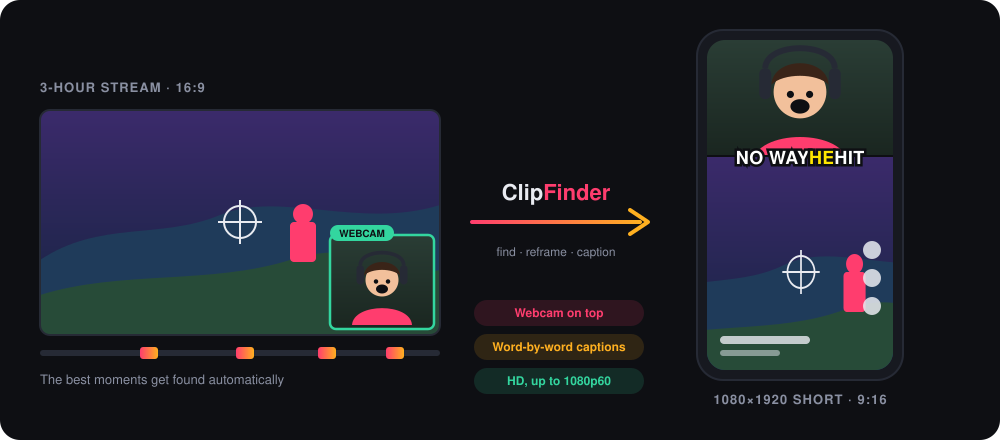
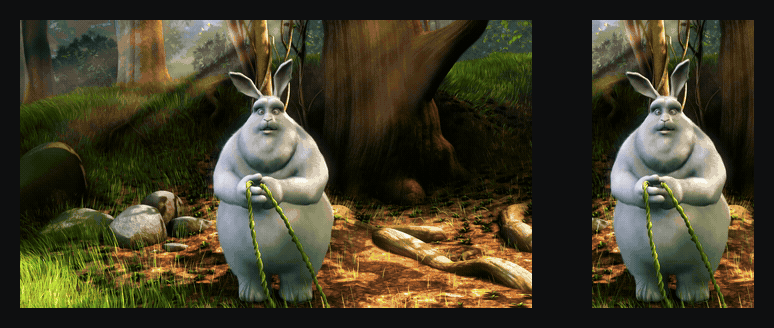
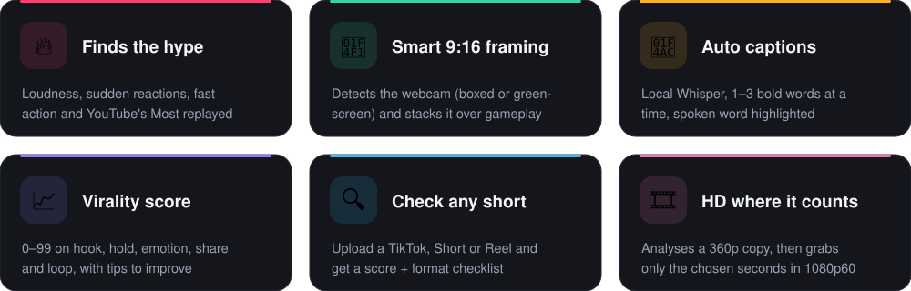
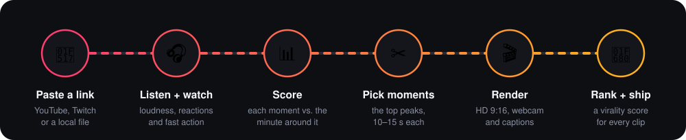
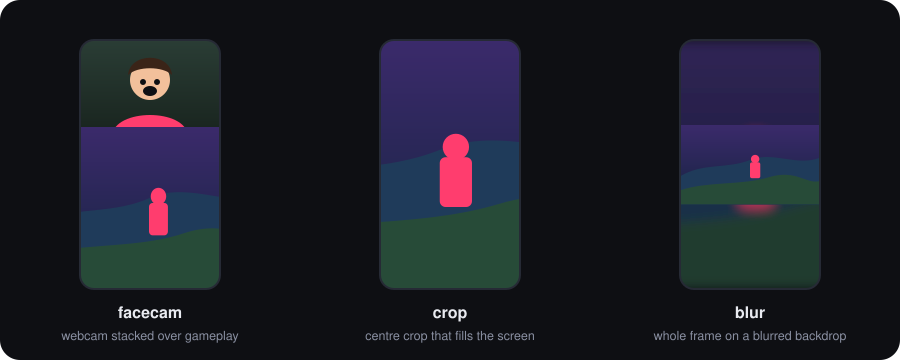

<div align="center">



<h3>Turn a 3-hour stream into ready-to-post TikToks, Shorts and Reels, automatically.</h3>

Paste a <b>YouTube</b> or <b>Twitch</b> link. ClipFinder finds the moments worth watching, reframes them to<br>
<b>9:16</b> with the streamer's webcam on top, burns in <b>word-by-word captions</b>, and scores every clip for <b>virality</b>.

<br>

[](https://github.com/ektedar/clipfinder/actions/workflows/ci.yml)
[](https://www.python.org)
[](https://docs.astral.sh/uv/)
[](https://github.com/astral-sh/ruff)
[](https://github.com/trufflesecurity/trufflehog)

**[See it](#-before--after) · [Features](#-features) · [How it works](#-how-it-works) · [Quick start](#-quick-start) · [Usage](#-usage) · [Development](#%EF%B8%8F-development)**

<br>



</div>

<br>

## 🎬 Before → After

<div align="center">

<table>
<tr>
<th align="center">📺 &nbsp;The original (16:9)</th>
<th align="center">📱 &nbsp;What ClipFinder cut (9:16)</th>
</tr>
<tr>
<td colspan="2" align="center">

</td>
</tr>
</table>


<sub>Four clips found in a 10-minute film with <b>zero manual editing</b>. Each one is a 10–15&nbsp;s, 1080×1920 MP4.<br>
Demo footage: <i>Big Buck Bunny</i> © Blender Foundation · <a href="https://peach.blender.org">peach.blender.org</a> · CC BY 3.0</sub>

</div>

<br>

## ✨ Features



> [!TIP]
> **Private by default.** Everything runs on your own machine: download, analysis, transcription and rendering.
> ffmpeg is bundled, so there's nothing else to install.

<br>

## 🧠 How it works



Every half-second is scored against **the minute and a half around it**, not the whole video, so a loud intro
or a quiet stretch never drowns out the real highlights. Here's the actual score for the film above, with the
clips it picked in green:


Each clip is cut so the peak lands **about 60% of the way in**: build-up before, reaction after.

### 🖼️ Three ways to frame a clip



`facecam` looks for a face that **stays put** across the clip. Webcams don't move and in-game characters do,
so it finds the streamer even with a green-screen cutout. If there's no cam, it falls back to `crop`.

<br>

## ⚡ Quick start

**1. Install [uv](https://docs.astral.sh/uv/).** It fetches the right Python for you.

```bash
brew install uv
```

**2. Clone and install.**

```bash
git clone https://github.com/ektedar/clipfinder.git && cd clipfinder
uv sync
```

**3. Launch.**

```bash
uv run app.py        # → open http://localhost:5050
```

> [!NOTE]
> The first captioned run downloads the Whisper `small` model (~460 MB). Captions use macOS's *Arial Black*;
> other systems get a fontconfig fallback.

<br>

## 🎮 Usage

### Web UI

| Tab | What you do |
| --- | --- |
| **🎬 Generate clips** | Paste a YouTube/Twitch link, choose clip count, length and framing, then hit **Find clips** |
| **📈 Check virality** | Drop in an existing short (MP4/MOV/WEBM/MKV, ≤ 500 MB) or paste its link to get a score and a format checklist |

### Command line

```bash
uv run clipper.py "https://www.twitch.tv/videos/..." --count 5
uv run clipper.py video.mp4 --mode blur --no-captions
```

<details>
<summary><b>All CLI options</b></summary>

<br>

| Option | Default | What it does |
| --- | --- | --- |
| `--count` | `5` | Number of clips |
| `--min` / `--max` | `10` / `15` | Clip length in seconds |
| `--mode` | `facecam` | `facecam`, `crop` or `blur` |
| `--cam` | `0.35` | Share of the height given to the webcam (0.25–0.5) |
| `--no-captions` | | Skip Whisper captions |
| `--no-virality` | | Skip virality scoring and ranking |
| `--out` | `output` | Output folder |

</details>

> [!TIP]
> **Smarter ranking with Claude.** Set `ANTHROPIC_API_KEY` (or run `ant auth login`) and ClipFinder adds a
> Claude rubric that compares candidate clips against each other. Without it, local signal-based scoring is used.

<br>

## 🛠️ Development

```bash
uv sync                   # app + dev tools (ruff, pytest, pre-commit)
uv run pre-commit install # secret scan + lint on every commit and push
uv run pytest             # tests
uv run ruff check --fix . # lint
uv run ruff format .      # format
```

<details>
<summary><b>🔐 Secret scanning with TruffleHog</b></summary>

<br>

[TruffleHog](https://github.com/trufflesecurity/trufflehog) runs **on your machine before anything reaches
GitHub**. The commit hook scans your staged changes, and the push hook scans every commit you're about to push.
If either finds something that looks like a secret, the commit or push is blocked. CI repeats the scan as a
backstop.

```bash
brew install trufflehog              # one-time
uv run pre-commit install            # installs both the commit and the push hook
uv run pre-commit run --all-files    # scan + lint everything now
```

Keep secrets such as `ANTHROPIC_API_KEY` in your shell environment or in a `.env.*` file. Both `.env.*` and
`*.env` are git-ignored. A false positive can be silenced with a `trufflehog:ignore` comment on that line.

</details>

<details>
<summary><b>🛡️ Dependency security</b></summary>

<br>

- **`.github/workflows/security.yml`** runs [pip-audit](https://github.com/pypa/pip-audit) against every
  package pinned in `uv.lock`. It runs on each push and PR and every Monday, and fails when any package has a
  known CVE.
- **Dependabot** (`.github/dependabot.yml`) opens monthly PRs to bump outdated packages and Actions. Turn on
  **Dependabot alerts** and **Dependabot security updates** under *Settings → Code security* to get alerted
  and receive a fix PR as soon as a CVE is published.

</details>

<details>
<summary><b>🏷️ Releases</b></summary>

<br>

Every push to `main` cuts a release automatically (`.github/workflows/release.yml`). It bumps the version in
`pyproject.toml`, tags `vX.Y.Z`, and publishes a GitHub Release with generated notes. The bump size comes
from [Conventional Commit](https://www.conventionalcommits.org) messages:

| Commit message | Bump |
| --- | --- |
| `feat!: …` or `BREAKING CHANGE:` in the body | major: `1.2.3 → 2.0.0` |
| `feat: …` / `feat(ui): …` | minor: `1.2.3 → 1.3.0` |
| anything else (`fix:`, `docs:`, …) | patch: `1.2.3 → 1.2.4` |

To pick the bump yourself, run it from *Actions → Release → Run workflow*.

</details>

<details>
<summary><b>📁 Project layout</b></summary>

<br>

| Path | What it is |
| --- | --- |
| `clipper.py` | Pipeline: download, analyse, score, select, webcam detection, render, virality ranking |
| `captions.py` | Whisper transcription and caption styling (`.ass` subtitles) |
| `virality.py` | Virality model (hook / hold / emotion / share / loop) and the optional Claude rubric |
| `checker.py` | Virality check and format checklist for an existing short |
| `app.py` / `index.html` | Local web UI (Flask + Bootstrap) |
| `models/` | YuNet face detector from [OpenCV Zoo](https://github.com/opencv/opencv_zoo) (MIT) |
| `tests/` | pytest suite for the pure scoring and caption logic |
| `docs/` | Images used in this README |

</details>

<br>

---

<div align="center">

<sub>Built with yt-dlp · ffmpeg · OpenCV · faster-whisper · Flask</sub><br>
<sub>Only clip videos you own or have permission to use.</sub>

</div>
