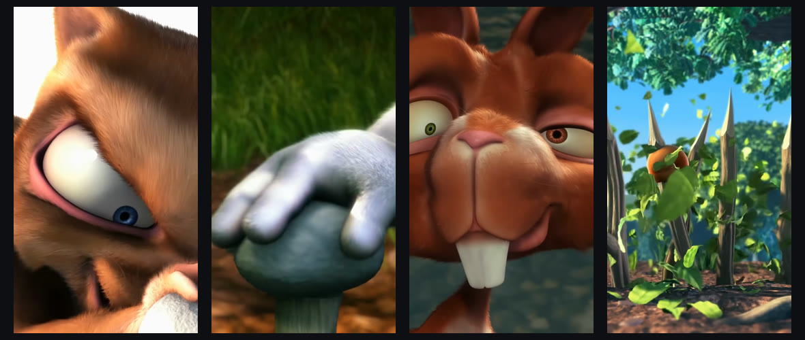
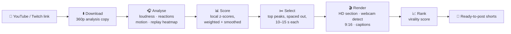
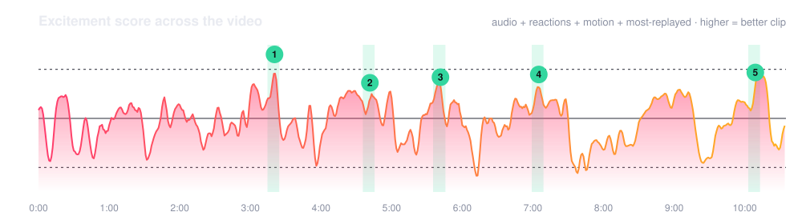

<div align="center">

# 🎬 ClipFinder

### Turn a 3-hour stream into ready-to-post vertical shorts in minutes.

Paste a **YouTube** or **Twitch** link. ClipFinder finds the most exciting moments, reframes them to
**9:16** with the streamer's **webcam stacked on top**, burns in **TikTok-style captions**, and scores each
clip for **virality**. Everything runs on your own machine.

[](https://github.com/ektedar/clipfinder/actions/workflows/ci.yml)

[](https://github.com/astral-sh/uv)
[](https://github.com/astral-sh/ruff)
[](https://github.com/trufflesecurity/trufflehog)


</div>

---

## ✨ See it in action

<table>
<tr>
<td width="28%" align="center" valign="top">
<br>
<sub>One of the auto-picked clips</sub>
</td>
<td valign="top">
<br>
<sub>Four clips found in a 10-minute film with <b>no manual editing</b>: each is a 10–15&nbsp;s, 1080×1920 MP4.</sub>
</td>
</tr>
</table>

<sub>Demo footage: <i>Big Buck Bunny</i> © Blender Foundation, <a href="https://peach.blender.org">peach.blender.org</a>, CC BY 3.0.</sub>

## 🚀 Features

| | |
| --- | --- |
| 🔥 **Finds the hype** | Scores every half-second on loudness, sudden reactions, on-screen action and YouTube's *Most replayed* heatmap |
| 📱 **Smart 9:16 framing** | Detects the streamer's webcam (boxed *or* green-screen cutout) and stacks it above the gameplay |
| 💬 **Auto captions** | Local Whisper transcription, burned in 1–3 bold words at a time with the spoken word highlighted |
| 📈 **Virality score** | Each clip is graded 0–99 on hook, hold, emotion, shareability and loop, with tips to improve it. A Claude rubric is used when an API key is set |
| 🔍 **Check any short** | Upload an existing TikTok, Short or Reel (or paste a link) and get a virality score plus a format checklist |
| 🎞️ **HD output** | Analyses a tiny 360p copy, then downloads **only the chosen seconds** in up to 1080p60 |
| 🔒 **Private by default** | Runs entirely on your machine; ffmpeg is bundled, so there's nothing else to install |

## 🧠 How it works



Every moment is compared with the **minute and a half around it**, not the whole video, so a loud intro or a
quiet stretch never drowns out the real highlights. This is the actual score for the film above, with the
picked clips in green:



Each clip is cut so the peak lands **about 60% of the way in**: build-up before, reaction after.

## 🖼️ Framing modes


`facecam` looks for a face that **stays in the same place** across the clip. In-game characters move
around, and the webcam doesn't. If no cam is found, ClipFinder falls back to `crop`.

## ⚡ Quick start

You'll need [**uv**](https://docs.astral.sh/uv/) (`brew install uv`). It installs the right Python for you.

```bash
git clone https://github.com/ektedar/clipfinder.git
cd clipfinder
uv sync                 # creates .venv with every dependency
uv run app.py           # → http://localhost:5050
```

> [!NOTE]
> The first captioned run downloads the Whisper `small` model (~460 MB) from Hugging Face.
> Captions use the macOS *Arial Black* font. On other systems fontconfig picks a fallback.

### Web UI

Run `uv run app.py`, open <http://localhost:5050>, and choose a tab:

- **Generate clips**: paste a link, pick a clip count, length and framing, then hit *Find clips*.
- **Check virality**: drop in an existing short (MP4/MOV/WEBM/MKV, up to 500 MB) or paste its link.

### Command line

```bash
uv run clipper.py "https://www.twitch.tv/videos/..." --count 5
uv run clipper.py video.mp4 --mode blur --no-captions
```

| Option | Default | What it does |
| --- | --- | --- |
| `--count` | `5` | Number of clips |
| `--min` / `--max` | `10` / `15` | Clip length in seconds |
| `--mode` | `facecam` | `facecam`, `crop` or `blur` |
| `--cam` | `0.35` | Share of the height given to the webcam (0.25–0.5) |
| `--no-captions` | | Skip Whisper captions |
| `--no-virality` | | Skip virality scoring and ranking |
| `--out` | `output` | Output folder |

### Optional: Claude-powered ranking

Set `ANTHROPIC_API_KEY` (or log in with `ant auth login`) and ClipFinder adds a Claude rubric that compares
candidate clips against each other. Without it, the local signal-based scoring is used.

## 🛠️ Development

ClipFinder is a [uv](https://docs.astral.sh/uv/) project. Dependencies live in `pyproject.toml` and are pinned
in `uv.lock`.

```bash
uv sync                          # app + dev tools (ruff, pytest, pre-commit)
uv run pytest                    # tests
uv run ruff check .              # lint   (add --fix to auto-fix)
uv run ruff format .             # format
```

### 🔐 Secret scanning with TruffleHog

[TruffleHog](https://github.com/trufflesecurity/trufflehog) runs **on your machine before anything reaches
GitHub**. The commit hook scans your staged changes, and the push hook scans every commit you're about to push.
If either finds something that looks like a secret, the commit or push is blocked. CI repeats the scan as a
backstop.

```bash
brew install trufflehog              # one-time
uv run pre-commit install            # installs both the commit and the push hook
uv run pre-commit run --all-files    # scan + lint everything now
```

Keep secrets such as `ANTHROPIC_API_KEY` in your shell environment or in a `.env.*` file. Both `.env.*` and
`*.env` are git-ignored. A false positive can be silenced with a `trufflehog:ignore` comment on that line.

### 🛡️ Dependency security

- **`.github/workflows/security.yml`** runs [pip-audit](https://github.com/pypa/pip-audit) against every
  package pinned in `uv.lock`. It runs on each push and PR and every Monday, and fails when any package has a
  known CVE.
- **Dependabot** (`.github/dependabot.yml`) opens monthly PRs to bump outdated packages and Actions. Turn on
  **Dependabot alerts** and **Dependabot security updates** under *Settings → Code security* to get alerted
  and receive a fix PR as soon as a CVE is published.

### 🏷️ Releases

Every push to `main` cuts a release automatically (`.github/workflows/release.yml`). It bumps the version in
`pyproject.toml`, tags `vX.Y.Z`, and publishes a GitHub Release with generated notes. The bump size comes
from [Conventional Commit](https://www.conventionalcommits.org) messages:

| Commit message | Bump |
| --- | --- |
| `feat!: …` or `BREAKING CHANGE:` in the body | major: `1.2.3 → 2.0.0` |
| `feat: …` / `feat(ui): …` | minor: `1.2.3 → 1.3.0` |
| anything else (`fix:`, `docs:`, …) | patch: `1.2.3 → 1.2.4` |

To pick the bump yourself, run it from *Actions → Release → Run workflow*.

### Project layout

| Path | What it is |
| --- | --- |
| `clipper.py` | Pipeline: download, analyse, score, select, webcam detection, render, virality ranking |
| `captions.py` | Whisper transcription and caption styling (`.ass` subtitles) |
| `virality.py` | Virality model (hook / hold / emotion / share / loop) and the optional Claude rubric |
| `checker.py` | Virality check and format checklist for an existing short |
| `app.py` / `index.html` | Local web UI (Flask + Bootstrap) |
| `models/` | YuNet face detector from [OpenCV Zoo](https://github.com/opencv/opencv_zoo) (MIT) |
| `tests/` | pytest suite for the pure scoring and caption logic |
| `docs/` | Images used in this README |

---

<div align="center">
<sub>Only clip videos you own or have permission to use.</sub>
</div>
